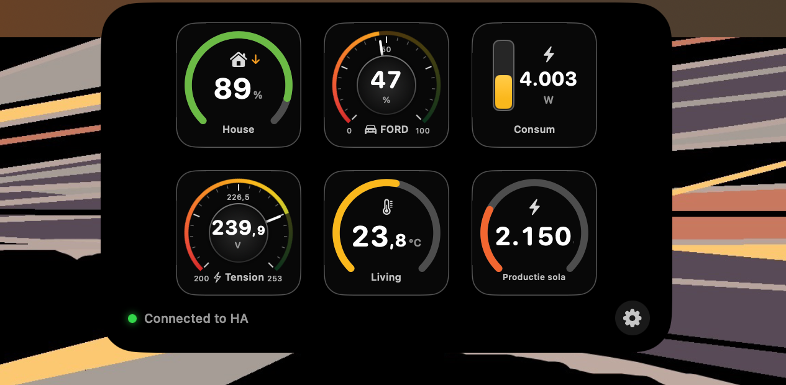
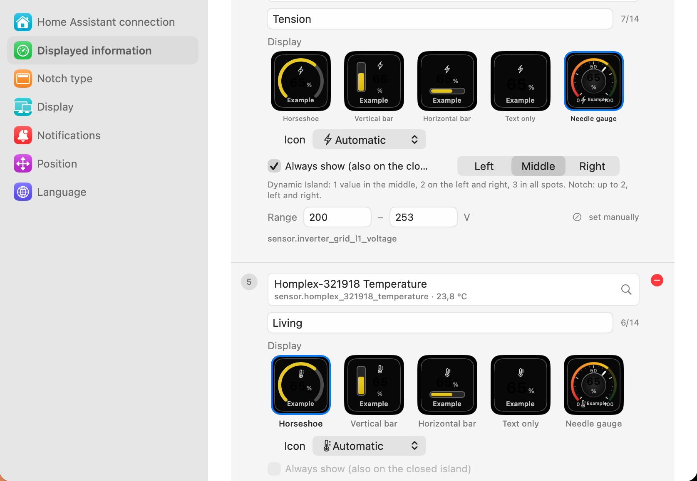

# HassNotch

**Your Home Assistant, right in your Mac's notch.**

HassNotch turns the notch of your MacBook, or a Dynamic Island–style pill on any Mac, into a live dashboard for your Home Assistant sensors. Hover over it to see your batteries, solar production, voltages, temperatures and more. Your Home Assistant notifications show up there too.

> HassNotch is an independent, community project. It is not affiliated with or endorsed by Home Assistant or Nabu Casa.

<p align="center">
  
</p>

---

## Features

### Live sensor dashboard
- **Real-time updates** over the Home Assistant WebSocket API. Values change the moment they change in HA, with no polling delay.
- **Up to 8 entities** in a 4 × 2 grid that scales automatically.
- **Searchable entity picker** with suggestions, so you don't need to remember entity IDs.
- **Five display styles per entity:**
  - Horseshoe gauge
  - Vertical bar
  - Horizontal bar
  - Needle gauge (classic car-dashboard style)
  - Text only
- **Color by level:** bars and gauges change color in 10% steps, from red through orange to green.
- **Automatic ranges:** min/max values are read from Home Assistant, including the ranges set on your dashboard Gauge cards. You can always override them manually.
- **Original precision:** values are shown as Home Assistant reports them, with smaller decimals for readability.
- **Charging indicator** (optional) for batteries, based on a sensor of your choice.
- **Smooth animations,** with optional odometer-style rolling digits.
- **Connection indicator** showing whether HassNotch is connected to Home Assistant.

### Always-visible values
Pin up to **3 values** to the collapsed Dynamic Island (left / center / right) or **2 values** beside the hardware notch. You see them without hovering. Opening and closing morphs the values smoothly into place.

### Notifications
Notifications sent from Home Assistant to your phone (`notify.mobile_app_…`) are mirrored to your Mac:
- The island widens (or the notch grows downward) with **scrolling text**.
- An optional discreet sound and a short attention animation.
- Choose which notify services are mirrored, and set the display duration.

<p align="center">
  
</p>

### Fits your setup
- **Two looks:** a classic **notch** sized to your MacBook's hardware notch, or a **Dynamic Island** pill for Macs without a notch (Mac mini, iMac, Mac Studio, external displays).
- **Display selection:** choose which monitor HassNotch lives on. It stays there regardless of where you're working when it launches.
- **Custom position** for the Dynamic Island (horizontal and vertical offset).
- **Trackpad haptics** on hover, with adjustable strength (built-in and Magic Trackpad).
- **Menu bar only** or **menu bar + Dock**, your choice.
- **Languages:** English, Romanian, German and French.

---

## Requirements

- macOS 26 (Tahoe) or later
- A Home Assistant instance reachable from your Mac: local network, Tailscale, Nabu Casa or your own domain
- A Home Assistant **long-lived access token**

---

## Installation

1. Download the latest `HassNotch.zip` from the [Releases](../../releases) page.
2. Unzip it and move **HassNotch.app** to your **Applications** folder.
3. Open it.

HassNotch is not notarized by Apple, so the first launch is blocked with a warning. To allow it:

1. Try to open HassNotch once and close the warning.
2. Go to **System Settings → Privacy & Security**.
3. Scroll down and click **Open Anyway** next to HassNotch, then confirm.

You only need to do this once.

---

## Setup

1. Click the HassNotch icon in the menu bar → **Settings…**
2. In **Home Assistant connection**, enter your server address, for example:
   - `http://homeassistant.local:8123`
   - `http://192.168.1.10:8123`
   - `http://your-ha.your-tailnet.ts.net:8123`
   - `https://your-domain.com`
3. Create a token in Home Assistant: **your profile → Security → Long-lived access tokens → Create token**. Name it `HassNotch`, copy it and paste it into HassNotch.
4. Go to **Displayed information**, add your entities and pick a display style for each one.

Hover over the notch or island to expand it. Click the gear icon to open Settings.

### Notifications need an admin user
Mirroring notifications relies on Home Assistant's `call_service` events, which HA only shares with **administrator** accounts. If notifications don't appear, make sure the token belongs to an admin user.

To test it, send a notification from **Developer Tools → Actions** in Home Assistant:

```yaml
action: notify.mobile_app_your_phone
data:
  message: "Hello from Home Assistant!"
```

---

## Privacy

- Your token is stored in the **macOS Keychain** and never leaves your Mac, except to talk to your own Home Assistant server.
- HassNotch has **no analytics, no tracking and no third-party servers**.
- It is **read-only**: it displays data and never controls your devices.

---

## Building from source

1. Clone the repository:
   ```bash
   git clone https://github.com/FocsaD/HassNotch.git
   ```
2. Open `HassNotch.xcodeproj` in Xcode.
3. In **Signing & Capabilities**, select your own team. A free Personal Team works.
4. Press **Run**.

To build a standalone copy: **Product → Archive → Distribute App → Custom → Copy App**.

---

## Troubleshooting

| Problem | Solution |
|---|---|
| *"App Transport Security policy requires the use of a secure connection"* | Update to the latest version, which allows `http://` addresses (local and Tailscale). |
| Can't connect | Use the base address only (no dashboard path), including the port, e.g. `:8123`. Check that the same address opens in your browser. |
| Asked for the Keychain password | Click **Always Allow**. It will not ask again. |
| Notifications don't appear | The token must belong to an **admin** user. Check that the notify service is enabled in **Settings → Notifications**. |
| No haptic feedback | Enable **Force Click and haptic feedback** in **System Settings → Trackpad**. *Quiet Click* makes all haptics weaker. |
| Island is on the wrong display | Choose the display in **Settings → Display**. |

---

## Support the project 🍺

HassNotch is free and open source. If you find it useful, you can buy me a beer:

[](https://ko-fi.com/V8Q82B3VFL)

Starring the repository, reporting bugs and suggesting features help a lot too.

---

## Feedback & contact

Found a bug or have an idea for a new feature?

- Open an [issue](../../issues) here on GitHub, or
- Email **[hassnotch@focsa.ro](mailto:hassnotch@focsa.ro)**

---

## License

Released under the [MIT License](LICENSE).

*Home Assistant is a trademark of the Open Home Foundation. All other trademarks belong to their respective owners.*
